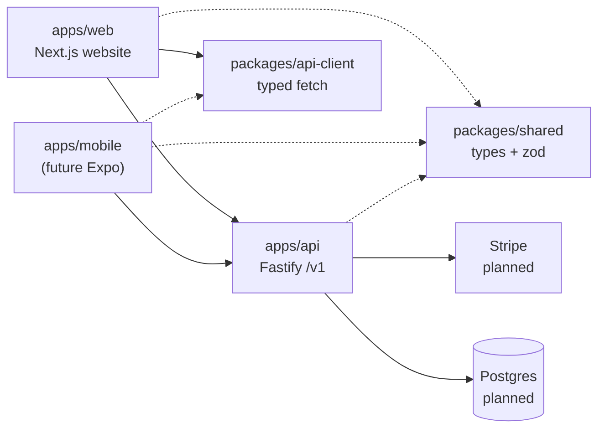

# Motter Budget App

Monorepo for Daniel Motter’s planned **Christian debt-free budgeting** product: a Next.js website and a shared backend API that a future mobile app can also call.

> **Status:** infrastructure / scaffolding only. No real accounts, database, payments, or deployment yet. Placeholder copy is marked clearly — no fake prices, launch dates, testimonials, or stats.

Brand tone matches the public channel site (dark theme, red accent, Romans 13:8 framing). The static marketing site remains separate: [daniel-motter-site](https://github.com/22dmotter/daniel-motter-site).

## Architecture



Both clients talk to the **same versioned API**. The website does **not** talk to a database directly.

## Folder structure

```
motter-budget-app/
├── apps/
│   ├── web/          # Next.js App Router website
│   ├── api/          # Fastify TypeScript API (/v1/*)
│   └── mobile/       # Placeholder note only (no Expo yet)
├── packages/
│   ├── shared/       # Zod schemas + TS types (User, Budget, Debt, Lead)
│   └── api-client/   # Typed fetch client for web + future mobile
├── docs/
│   └── ARCHITECTURE.md
├── .github/workflows/ci.yml
└── package.json      # npm workspaces
```

### Website routes (`apps/web`)

| Path | Purpose |
|------|---------|
| `/` | Placeholder homepage (stewardship / Romans 13:8 / Proverbs 22:7) |
| `/about` | Project framing |
| `/pricing` | Placeholder — **no prices** |
| `/login`, `/signup` | Placeholder UI only — **no real auth** |
| `/dashboard` | Placeholder; probes `GET /v1/health` via typed client |
| `not-found` | 404 page |

### API routes (`apps/api`)

| Path | Status |
|------|--------|
| `GET /v1/health` | Working |
| `/v1/auth/*` | Stub → 501 |
| `/v1/budgets/*` | Stub → 501 |
| `/v1/debts/*` | Stub → 501 |
| `/v1/payments/*` (incl. Stripe webhook) | Stub → 501 |
| `POST /v1/leads` | Stub → 501 |

## Prerequisites

- **Node.js** ≥ 20.19 (see `.nvmrc`)
- **npm** 10+ (workspaces)
- Optional later: Postgres, Stripe CLI

## Local setup

```bash
git clone https://github.com/22dmotter/motter-budget-app.git
cd motter-budget-app
npm install

# Copy env examples (placeholder values only — never commit real secrets)
cp apps/api/.env.example apps/api/.env
cp apps/web/.env.example apps/web/.env.local
```

### Environment

**API (`apps/api/.env`)** — see `.env.example` for:

- `PORT`, `HOST`, `CORS_ORIGINS`
- `DATABASE_URL` (unused until ORM is added)
- `JWT_SECRET` / `AUTH_SECRET` (unused until auth)
- `STRIPE_SECRET_KEY`, `STRIPE_WEBHOOK_SECRET`, `STRIPE_PUBLISHABLE_KEY`

**Web (`apps/web/.env.local`)**:

- `NEXT_PUBLIC_API_URL=http://localhost:4000`
- `NEXT_PUBLIC_STRIPE_PUBLISHABLE_KEY` (optional placeholder)

Env is validated with **zod** when the API starts.

## Scripts

| Command | What it does |
|---------|----------------|
| `npm run dev` | Starts API (port **4000**) + web (port **3000**) together |
| `npm run dev:api` / `npm run dev:web` | Run one app |
| `npm run build` | Build shared → api-client → api → web |
| `npm run typecheck` | TypeScript check across packages |
| `npm test` | API vitest suite (includes health check) |
| `npm run lint` | Lint where configured |

```bash
npm run dev
# Web:  http://localhost:3000
# API:  http://localhost:4000/v1/health
```

## CI

GitHub Actions (`.github/workflows/ci.yml`) runs on push/PR to `main`: install → typecheck → build → test. **No deploy workflow.**

## Next steps

1. **Database + ORM** — Postgres + Prisma (or Drizzle); wire `DATABASE_URL`.
2. **Auth** — email/password or magic link; JWT/session; implement `/v1/auth/*`.
3. **Stripe** — products/prices, Checkout, webhook signature verification on `/v1/payments/webhook`.
4. **Lead capture** — persist `POST /v1/leads`; optional email provider.
5. **Hosting** — e.g. Vercel (web) + Fly/Railway/Render (API) + managed Postgres.
6. **Mobile** — scaffold Expo under `apps/mobile` using `@motter/api-client`.
7. **Content** — replace placeholder copy; keep honest about launch status.

## License / disclaimer

Private repository. Not financial advice. Scripture quotations for framing only.
