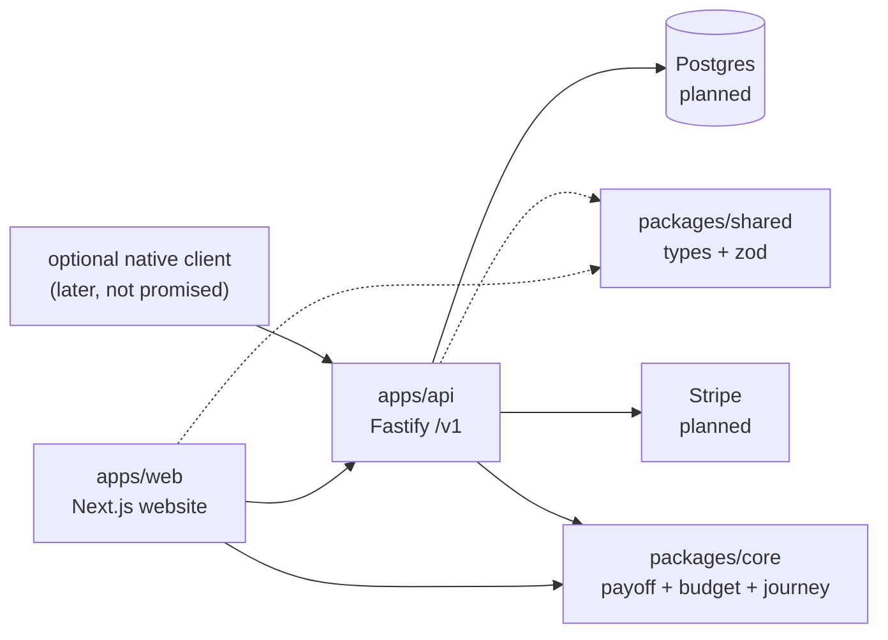

# Motter Budget App

Monorepo for **Budget App** — a debt payoff calculator and tracker that runs in the browser. The website *is* the product. A shared API keeps a native client possible later, but there is no separate app to download.

> **Status:** The calculator and My Plan tracker work in the browser (localStorage, JSON backup). Accounts, hosted API, and payments come later. No fake prices, launch dates, or testimonials.

The website UI uses a light fintech theme (navy + crimson accent) with Romans 13:8 / Proverbs 22:7 framing. The personal channel site remains separate: [daniel-motter-site](https://github.com/22dmotter/daniel-motter-site).

## Live preview

Static website (no API): **[https://22dmotter.github.io/budget-app-motter/](https://22dmotter.github.io/budget-app-motter/)**

To rebuild and publish the site to the `gh-pages` branch:

```bash
npm run deploy:pages
```

That runs a Next.js static export with `PAGES_BASE_PATH=/budget-app-motter`, adds `.nojekyll`, and pushes `apps/web/out` to GitHub Pages. The Fastify API is **not** deployed with this preview.

## Why this exists

This project grew out of a personal journey. Daniel Motter is working to pay off about $49k of debt, and he's documenting every step on his YouTube channel, [@DanielEMotter](https://www.youtube.com/@DanielEMotter), along with the real numbers on [his website](https://22dmotter.github.io/daniel-motter-site/).

Two verses shape the heart behind it:

> "The rich rules over the poor, and the borrower is the slave of the lender." (Proverbs 22:7, ESV)

> "Owe no one anything, except to love each other, for the one who loves another has fulfilled the law." (Romans 13:8, ESV)

Debt can quietly take away our freedom, our peace, and our ability to give generously. The goal of this app is simple: help people see where their money goes, make a plan to get free, and steward what they've been given well, so there's more room to love their families and neighbors. It's built as a small ministry, with honesty, grace, and practical tools over pressure or guilt. Wherever you're starting from, you're welcome here.

## Free spreadsheet downloads

Static `.xlsx` templates live in [`apps/web/public/downloads/`](apps/web/public/downloads/) and are listed on `/downloads`. Regenerate them with:

```bash
python3 -m venv .venv-xlsx && .venv-xlsx/bin/pip install openpyxl
.venv-xlsx/bin/python scripts/generate_budget_spreadsheets.py
```

Titles pull the product name from `apps/web/src/config/brand.ts` via `apps/web/src/config/downloads.ts`.

## Renaming the product brand

The final product name is undecided. **UI brand copy lives in one place:**

[`apps/web/src/config/brand.ts`](apps/web/src/config/brand.ts)

Change `name`, `tagline`, `description`, and related fields there. The header logo, footer, page titles/metadata, and homepage copy import that config. Repo name, npm package names, and GitHub Pages URL stay as-is until you rename those separately. Founder story fields (`founder.*`) are for the About page only — not the product brand.

## Architecture



The **web app is the primary client** and talks to `@motter/core` in the browser. The same engine powers `POST /v1/calculate/*`. The website does **not** talk to a database directly.

## Folder structure

```
budget-app-motter/
├── apps/
│   ├── web/          # Next.js App Router website
│   ├── api/          # Fastify TypeScript API (/v1/*)
│   └── mobile/       # Reserved only — optional future client, not a product surface
├── packages/
│   ├── core/         # Payoff, budget, progress, journey engines (no DOM)
│   ├── shared/       # Zod schemas + TS types (AppState, Debt, Budget, …)
│   └── api-client/   # Typed fetch client for a future hosted API
├── docs/
│   └── ARCHITECTURE.md
├── .github/workflows/ci.yml
└── package.json      # npm workspaces
```

### Website routes (`apps/web`)

| Path | Purpose |
|------|---------|
| `/` | Homepage with a 3-field debt-free date quick start |
| `/about` | Project framing |
| `/pricing` | Preview of proposed plans (checkout is not live) |
| `/login`, `/signup` | Placeholder UI only — **no real auth** |
| `/calculator` | Debt payoff calculator (snowball / avalanche, schedule, save as My Plan) |
| `/app` | My Plan — budget, debts, logging, journey/milestones (PWA) |
| `/dashboard` | Redirects to `/app` |
| `/downloads` | Free budgeting spreadsheets (.xlsx) for Excel / Google Sheets / Numbers |
| `not-found` | 404 page |

### API routes (`apps/api`)

| Path | Status |
|------|--------|
| `GET /v1/health` | Working |
| `/v1/auth/*` | Stub → 501 |
| `/v1/budgets/*` | Stub → 501 |
| `/v1/debts/*` | Stub → 501 |
| `/v1/payments/*` (incl. Stripe webhook) | Stub → 501 |
| `POST /v1/leads` | Stub → 501 |

## Prerequisites

- **Node.js** ≥ 20.19 (see `.nvmrc`)
- **npm** 10+ (workspaces)
- Optional later: Postgres, Stripe CLI

## Local setup

```bash
git clone https://github.com/22dmotter/budget-app-motter.git
cd budget-app-motter
npm install

# Copy env examples (placeholder values only — never commit real secrets)
cp apps/api/.env.example apps/api/.env
cp apps/web/.env.example apps/web/.env.local
```

### Environment

**API (`apps/api/.env`)** — see `.env.example` for:

- `PORT`, `HOST`, `CORS_ORIGINS`
- `DATABASE_URL` (unused until ORM is added)
- `JWT_SECRET` / `AUTH_SECRET` (unused until auth)
- `STRIPE_SECRET_KEY`, `STRIPE_WEBHOOK_SECRET`, `STRIPE_PUBLISHABLE_KEY`

**Web (`apps/web/.env.local`)**:

- `NEXT_PUBLIC_API_URL=http://localhost:4000`
- `NEXT_PUBLIC_STRIPE_PUBLISHABLE_KEY` (optional placeholder)

Env is validated with **zod** when the API starts.

## Syncing Daniel’s public ledger

`npm run sync:daniel` reads `/workspace/daniel-motter-site/debt-contributions.js` (read-only) into `apps/web/src/data/daniel-journey.json`. See `docs/MILESTONES.md`.

## Scripts

| Command | What it does |
|---------|----------------|
| `npm run dev` | Starts API (port **4000**) + web (port **3000**) together |
| `npm run dev:api` / `npm run dev:web` | Run one app |
| `npm run build` | Build shared → api-client → api → web |
| `npm run typecheck` | TypeScript check across packages |
| `npm test` | API vitest suite (includes health check) |
| `npm run lint` | Lint where configured |
| `npm run build:pages` | Static export of `apps/web` with GitHub Pages base path |
| `npm run deploy:pages` | Build pages export and push to the `gh-pages` branch |
| `npm run sync:daniel` | Refresh the build-time snapshot of Daniel’s public ledger |

```bash
npm run dev
# Web:  http://localhost:3000
# API:  http://localhost:4000/v1/health
```

## CI

A GitHub Actions workflow example lives at `docs/ci.workflow.example.yml` (install → typecheck → build → test; **no deploy**).

It is not installed under `.github/workflows/` in this initial push because the authenticated `gh` OAuth token on the scaffolding machine lacked the `workflow` scope. To enable CI: copy the example into `.github/workflows/ci.yml` and push with a token/PAT that includes the `workflow` scope (or add it via the GitHub UI).

## Next steps

1. **Database + ORM** — Postgres + Prisma (or Drizzle); wire `DATABASE_URL`.
2. **Auth** — email/password or magic link; JWT/session; implement `/v1/auth/*`.
3. **Stripe** — products/prices, Checkout, webhook signature verification on `/v1/payments/webhook`.
4. **Lead capture** — persist `POST /v1/leads`; optional email provider.
5. **Hosting** — static web preview is on GitHub Pages; later e.g. Vercel (web) + Fly/Railway/Render (API) + managed Postgres.
6. **Optional native client** — only if needed later; the website remains the product. Reuse `@motter/core` and `/v1`.
7. **Accounts & billing** — auth, hosted backup, and Stripe entitlements. Pricing stays a preview until checkout is live.

## Contributing

This app is being built in the open, right alongside Daniel's own debt-payoff journey, and you're welcome to build it with us. If you share the mission of helping people get out of debt and steward their money well, there's a place for you here, whatever your experience level.

- **Spot a bug or have a question?** [Open an issue](https://github.com/22dmotter/budget-app-motter/issues).
- **Have an idea that would help someone get free of debt?** Suggest a feature in an issue and tell us the story behind it.
- **Want to write code or improve the docs?** Fork the repo, make your change on a branch, run `npm run typecheck`, `npm run build`, and `npm test`, then open a pull request explaining what you changed and why.

Please be kind and patient with one another. Money can be a tender subject, so every conversation here should leave people more hopeful than when they arrived. And never commit real keys, passwords, or anyone's personal financial data.

## License / disclaimer

Released under the [MIT License](LICENSE). Not financial advice. Scripture quotations are from the ESV® Bible (The Holy Bible, English Standard Version®), copyright © 2001 by Crossway, a publishing ministry of Good News Publishers. Used by permission. All rights reserved.
